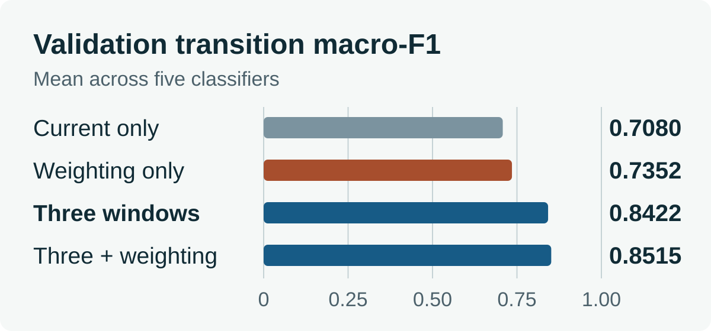
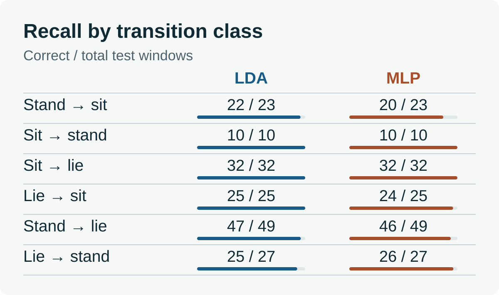
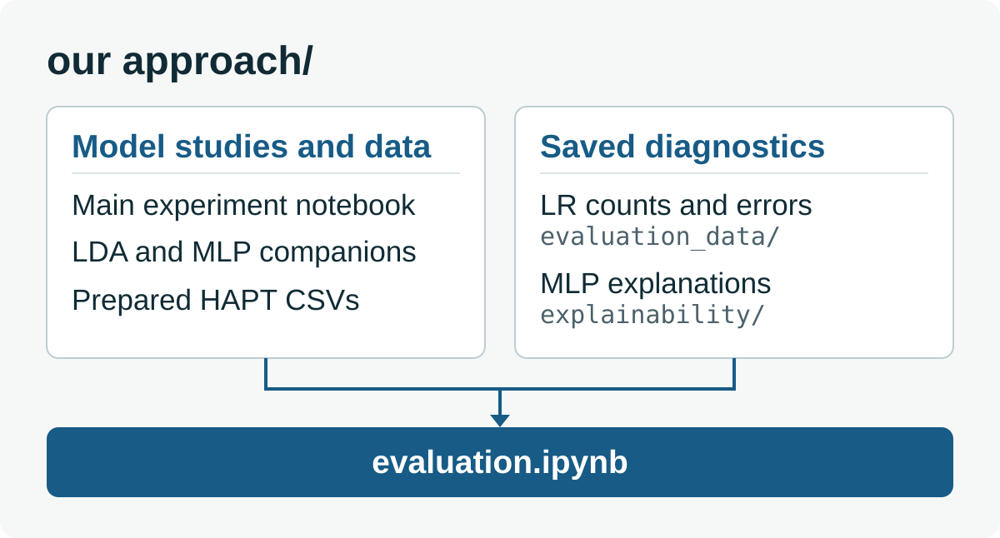

# Improving recognition of rare postural transitions

A CS3244 group study on recognising brief movements such as sit-to-stand from smartphone sensor windows. In HAPT, the six transition classes account for just **4.53% of training windows**. We compare six classifier families to see how much neighbouring windows, class weighting and oversampling help.

[Open the evaluation notebook](our%20approach/evaluation.ipynb) · [Open the main experiments](our%20approach/Improving%20Rare%20Postural%20Transitions.ipynb)

## What improved recognition

Adding the preceding and following windows raised mean validation transition macro-F1 from **0.7080 to 0.8422** across the five classifiers with a weighting comparison. Weighting alone reached **0.7352**. LDA, which used equal class priors, also improved from **0.7567 to 0.8917** when given three windows with memory off.



*Final report §6.1, Table 3. Three participant-grouped folds. Oversampling was off, and the MLP used posture memory in all four conditions.*

## Final model comparison

Models were selected on training-participant validation folds. The test columns describe the official split of 3,162 windows from nine participants, including 166 true transition windows.

| Model | Windows | Val. F1 | Test F1 |
| --- | ---: | ---: | ---: |
| Shrinkage LDA | 7 | **0.9699** | **0.9779** |
| MLP | 11 | 0.9302 | 0.9716 |
| Logistic regression | 7 | 0.9048 | 0.9373 |
| Linear SVM | 7 | 0.8834 | 0.9322 |
| Random forest | 9 | 0.9201 | 0.9296 |
| XGBoost | 7 | 0.9033 | 0.9285 |

*Final report §6.1, Table 4. F1 is macro-averaged over six transition classes. LDA and MLP use posture memory. Logistic regression uses PCA-400.*

LDA reached **97.82%** test accuracy and identified **161 of 166** true transition windows. The MLP identified **158 of 166**, including one more lie-to-stand window than LDA. PCA-400 saved **28% to 39%** in two paired logistic-regression timing runs. The MLP's PCA-500 setting improved validation transition F1, with mixed timing results.



*Final report §6.2, Table 6. Both models used posture memory.*

### What the MLP uses

Grouped occlusion, Integrated Gradients and feature ablation examine the base MLP. In one lie-to-sit error, replacing the preceding window switched the prediction from sitting to lie-to-sit under all four references. Within that window, different acceleration features favoured opposing classes. In the exploratory LIME-style analysis, none of the ten selected sparse surrogates passed all audit criteria. See [evaluation §7.7](our%20approach/evaluation.ipynb) for the checks and results.

## Project structure



| Path | Contents |
| --- | --- |
| [Main experiment notebook](our%20approach/Improving%20Rare%20Postural%20Transitions.ipynb) | Shared model code, controlled comparisons and final configurations |
| [LDA companion](our%20approach/companion/LDA%20external.ipynb) · [MLP companion](our%20approach/companion/MLP%20external.ipynb) | Model-specific experiments and saved test predictions |
| [Evaluation notebook](our%20approach/evaluation.ipynb) | Model comparison, error analysis and local explainability |
| [Prepared data](our%20approach/wrangled%20data/) · [LR diagnostic](our%20approach/evaluation_data/raw_seven_window_lr.json) · [MLP explainability](our%20approach/explainability/) | Data and analyses used in the evaluation |

Earlier experiments are in `Previous Attempts/`. `doc/` contains project materials. The final report is maintained in Overleaf.

## Run the evaluation

The evaluation notebook includes saved tables and figures. To regenerate them, run from the repository root:

```sh
python -m pip install \
  jupyterlab numpy pandas matplotlib
python -m jupyterlab
```

Open `our approach/evaluation.ipynb` and choose **Run All Cells**. Evaluation reads the prepared data and recorded results without fitting classifiers. To recompute the MLP analysis separately, use the [occlusion and IG script](our%20approach/explainability/analyze.py) and the [local surrogate script](our%20approach/explainability/local_surrogates.py).

## Scope and data credit

The official test participants were inspected during development, so these scores are descriptive. The selected models use future windows and need offline or delayed inference. The prepared CSVs lack within-participant recording boundaries, and several transition classes have small test counts.

The study uses the [HAPT dataset by Reyes-Ortiz, Anguita, Oneto and Parra](https://archive.ics.uci.edu/dataset/341/smartphone%2Bbased%2Brecognition%2Bof%2Bhuman%2Bactivities%2Band%2Bpostural%2Btransitions), distributed by UCI under [CC BY 4.0](https://creativecommons.org/licenses/by/4.0/).
